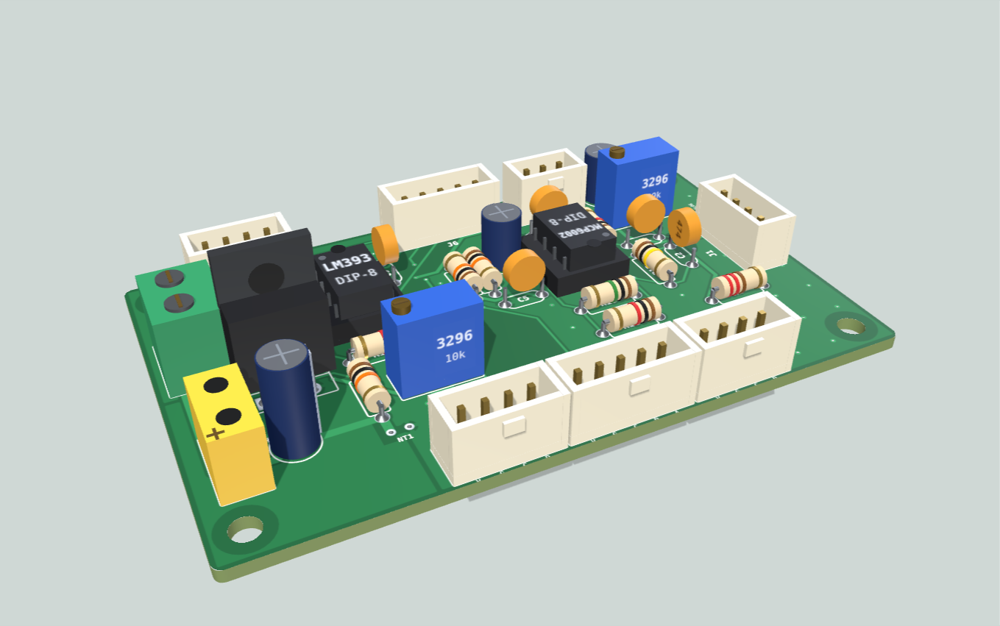
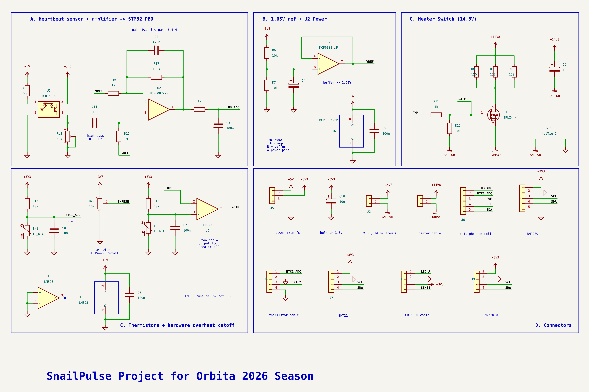
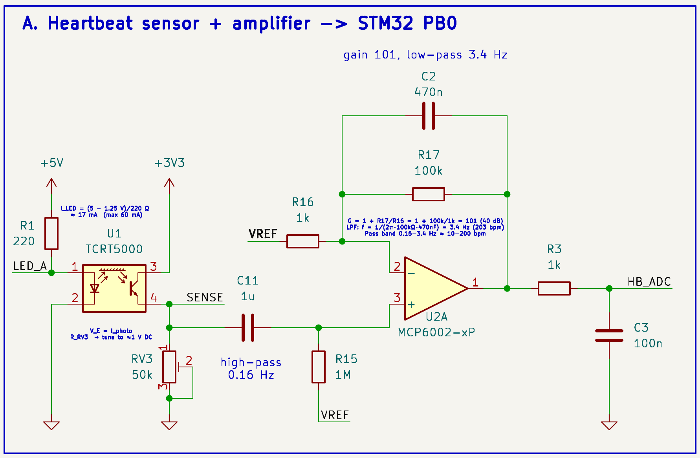
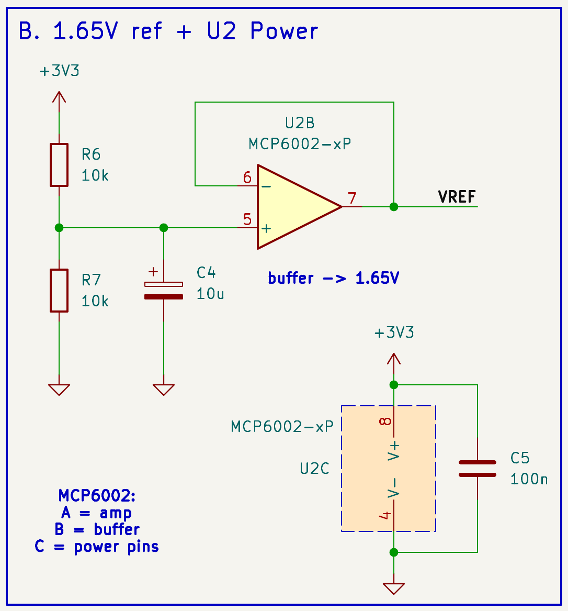
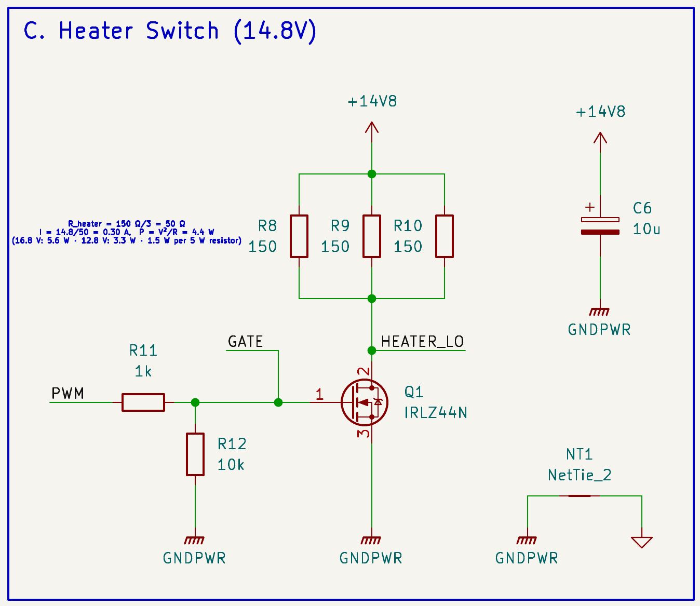
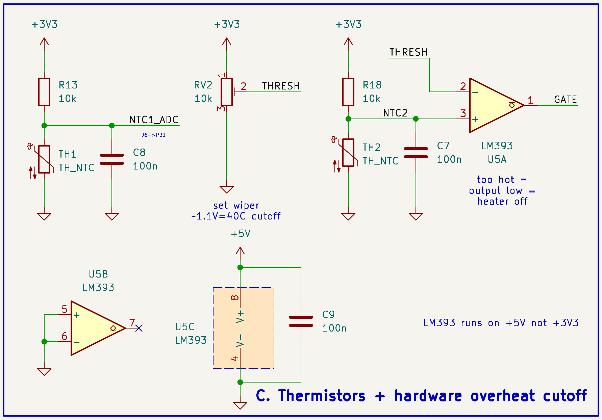
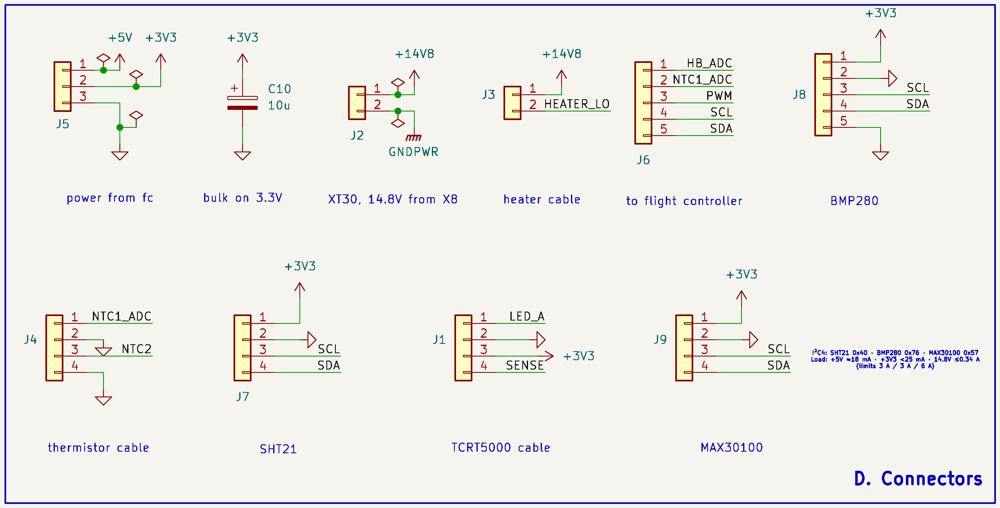
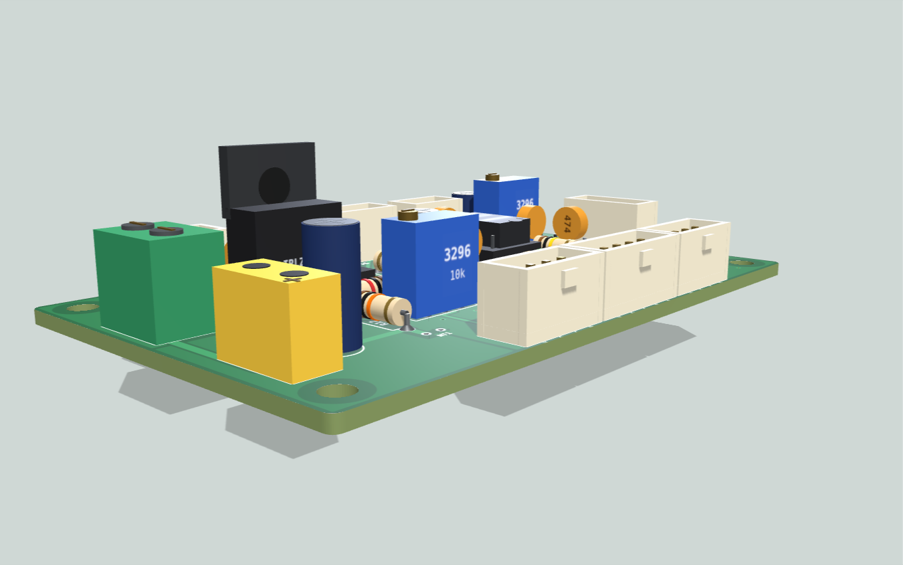
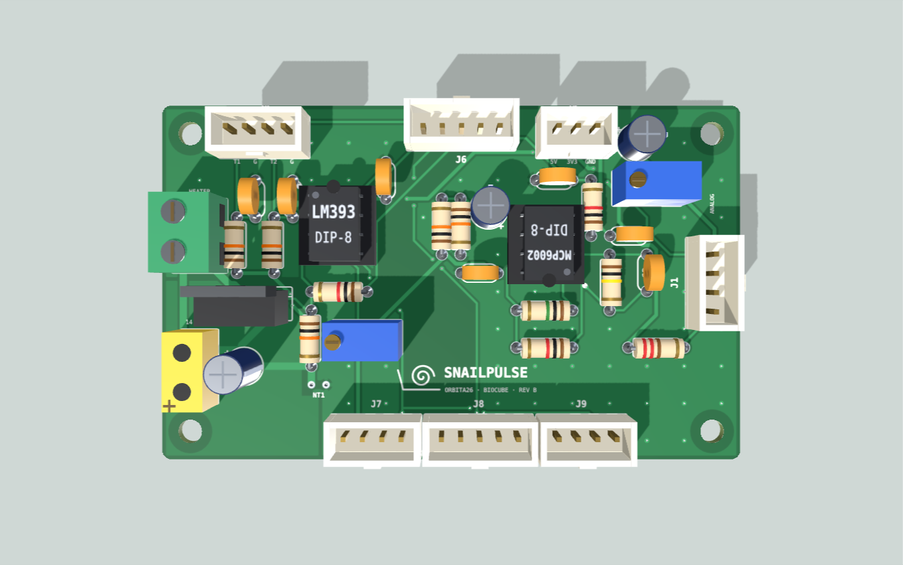
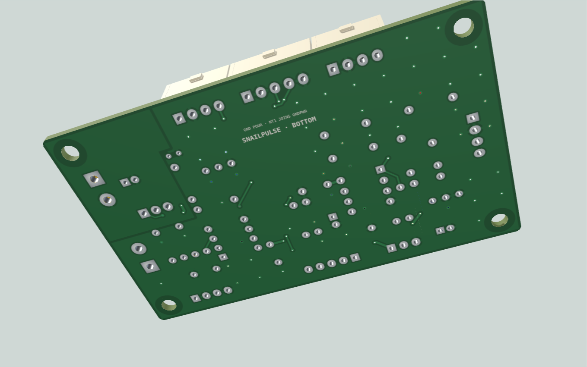

# SnailPulse — Orbita 2026

**Measuring a living snail's heartbeat in the stratosphere.**
International Space Tournament *Orbita* 2026 · 3U CubeSat on the IntroSat.Platform · Team mentor: Ezoza Yuldosheva · Electronics and firmware: Azizbek No'monjonov

We fly two garden snails (*Cornu aspersum*) to about 24 km. Each has an infrared sensor glued to its shell that watches the heart beat through the shell. **Snail 1** has a TCRT5000 whose tiny signal goes through our analog band-pass amplifier into PB0. **Snail 2** has a MAX30100 optical pulse sensor read over I²C. The satellite's flight controller counts both hearts' beats and radios them to the ground every 2 seconds. Meanwhile a heater keeps the snail's box at 20 °C, and a hardware cutoff protects it even if the software fails.



*Concept render of the payload board. The flight unit is built on perfboard from the same schematic. [3D preview →](#3d-preview)*

## Schematic



*Rev B schematic, plotted from `hardware/kicad/Orbita26.kicad_sch` on 24 Oct 2026. Vector version for zooming and printing: [hardware/Orbita26_schematic.pdf](hardware/Orbita26_schematic.pdf). Block close-ups are under [How it works](#how-it-works).*

## What's new (24 Oct 2026)

- **Schematic picture redrawn.** `docs/images/schematic_full.png` and the five block close-ups now show rev B (`HEATER_LO`, J3 switched by Q1, NTC2 on J4.3). The old pictures were still from before the fixes. A vector PDF of the sheet is in `hardware/`.
- **Tournament final paperwork** added for the trip to Moscow (see [Orbita 2026 final](#orbita-2026-final-moscow)).
- **Parts list** added in two more forms: `SnailPulse_BOM.xlsx` at the top level (same file as `hardware/SnailPulse_BOM.xlsx`) and `Orbita SnailPulse Parts List.numbers` (the Numbers version with shop names and links).
- **Radio reference photo**: `micoair_lr900_915mhz_500mw_radio_telemetry_with_30km_range_5_550x550.jpeg`, the MicoAir LR900 telemetry radio pair (915 MHz, 500 mW).

## What's new (23 Oct 2026, schematic rev B)

The schematic in `hardware/kicad/Orbita26.kicad_sch` was re-checked today by extracting its netlist and comparing it pin by pin with the intended design.

**Result: all 21 nets connect exactly as designed.** The three rev A wiring errors are gone, and the only unconnected pin is the intentional no-connect on U5 pin 7.

| Change since rev A | Status |
|---|---|
| J3 heater cable now switched by Q1 (`HEATER_LO` on J3.2 and the Q1 drain) instead of sitting across the battery | ✅ fixed |
| J1 sensor cable connected to the circuit (`LED_A`, `SENSE` labels on both ends) | ✅ fixed |
| J4 pin 3 connected to the cutoff thermistor node (`NTC2` on R18 / TH2 / C7 / U5.3) | ✅ fixed |
| `HEATER_L0` (zero) renamed `HEATER_LO` | ✅ fixed |
| PWR_FLAG on every power net, including GNDPWR | ✅ added |
| Footprints on every on-board part (JST-XH, XT30, 5.0 mm screw terminal for the heater, DIP-8 sockets, THT R/C/trimmers, net tie) | ✅ added |
| U1 (TCRT5000), TH1, TH2, R8–R10 marked "exclude from board" (they live on cables) | ✅ done |
| Title block still says **rev A, 22 Oct** | ⬜ change to rev B |
| Reference gaps: R2, R4, R5, R14, C1, RV1, U3, U4 are unused | ⬜ run *Annotate* before exporting the BOM |

New documents:

- **[docs/Firmware_and_Integration.md](docs/Firmware_and_Integration.md)** explains how the flight code works (sampling, beat detection, heater control, packets, SD log, fault handling) and how SnailPulse plugs into the IntroSat flight controller, power module and radio board.
- **[docs/3d/](docs/3d/)** has the 3D preview of how the board could look as a PCB.

## How it works

| Block | What it does | Key numbers |
|---|---|---|
| **A. Heartbeat sensor + amplifier** | TCRT5000 IR reflectance through the shell → RV3 load → high-pass → ×101 amplifier with low-pass → PB0 | LED 17 mA · pass band 0.16–3.4 Hz (10–200 bpm) · gain 101 (40 dB) |
| **B. 1.65 V reference** | Divider + MCP6002 buffer; centres the signal in the 0–3.3 V ADC range | 3.3 V / 2, filtered at 3.2 Hz |
| **C1. Heater switch** | 3 × 150 Ω heater, IRLZ44N low-side switch, PWM from PC6 | 50 Ω · 0.30 A · 4.4 W at 14.8 V |
| **C2. Thermistors + hardware cutoff** | NTC1 → PB1 for firmware control; NTC2 → LM393 cuts the heater at ~40 °C with no software | 40 °C ↔ 1.14 V · −30 mV/°C |
| **D. Connectors** | Locking JST-XH plugs to the sensor, thermistors, flight controller, BMP280 and MAX30100 | I²C4 = PD12/PD13 · power from IntroBus_L and X8 |

Full sheet: [Schematic](#schematic) above.

<details><summary>Block close-ups (rev B)</summary>






</details>

Rev A review and the reasoning behind every block: [docs/Schematic_Review.md](docs/Schematic_Review.md).

## How it connects to the IntroSat.Platform

SnailPulse doesn't replace any platform board. It adds one payload board and our firmware on the existing flight controller (STM32H750).

| Our plug | Goes to | Signals |
|---|---|---|
| **J6** (5-pin) | IntroBus_L | PB0 heartbeat ADC · PB1 MQ-7 AO via 10k/20k divider (rev B: heater thermistor) · PC6 DHT-11 data (rev B: heater PWM) · DHT-11 and MQ-7 on +5 V · PD12/PD13 I²C4 |
| **J5** (3-pin) | IntroBus_L | +5V_IS · +3V3_IS · GND |
| **J2** (XT30) | Power module X8 | 14.8 V for the heater only (red +, black −) |
| **J7 / J8 / J9** | (empty: GY-21 removed 30 Oct) · BMP280 · MAX30100 (snail 2's pulse sensor) | I²C4 at — · 0x76 · 0x57 |

Data path: PB0 (snail 1) is sampled at 50 Hz in a timer interrupt and the MAX30100 (snail 2) is read at 100 Hz over I²C4 → one beat detector per snail → binary packet → UART1 → communication board → LoRa 433 MHz → ground LoRa-UART module → `ground/snailpulse_ground.py`. The full story, with the pin table, power budget and failure handling, is in [docs/Firmware_and_Integration.md](docs/Firmware_and_Integration.md).

## 3D preview

| | |
|---|---|
|  |  |
|  |  |

- `docs/3d/SnailPulse_3D.html`: interactive viewer. Download it and open it in a browser (needs internet for the 3D library). Turn the board, look underneath, click any part to see its job and its nets.
- `docs/3d/SnailPulse_board.glb`: the same model as a 3D file, in metres. Opens in Blender, the Windows 3D Viewer, or any online glTF viewer.

Reference numbers in the preview match the schematic. It is a **concept render, not a fabrication file**: the parts and footprints are real, but the board outline, positions and the traces painted on its surface are illustrative.

## Orbita 2026 final (Moscow)

The final runs from **26 October to 1 November 2026** at Bauman Moscow State Technical University, organized by ANO CIKENO together with HSE University. Arrival and workstation setup are on 25 October.

| File | What it is |
|---|---|
| `International_tournament_Orbita_Schedule_EN.pdf` | Day-by-day programme of the final (venues, lab hours, excursions) |
| `Письмо ЦИКЕНО Узбекистан.pdf` | Organizers' letter No. 22-10-26/3 (22 Oct 2026) confirming the Uzbek delegation as finalists |
| `russia team.pdf` | Uzbekistan delegation list with each member's role (in Uzbek) |
| `ClearView — presentation (EN).pdf` | Our delegation's Cosmonautics Project Contest entry: *ClearView*, a spacesuit visor wiper with a self-cleaning edge (13 slides) |

## Repository

**Start here:** [HANDOFF.md](HANDOFF.md) (where the work stands and what's next) · [docs/Software_Setup.md](docs/Software_Setup.md) (build, flash and debug on macOS/Windows, also from Russia; Mac: `bash scripts/mac_setup.sh`) · [docs/Bench_Test.md](docs/Bench_Test.md) (what plugs where, power order, upload, ground monitor) · [radio_handoff/](radio_handoff/README.md) (for the radio technician) · [CLAUDE.md](CLAUDE.md) (project rules, pins, build and test commands) · [hardware/perfboard/SnailPulse_perfboard_build.html](hardware/perfboard/SnailPulse_perfboard_build.html) (build guide).

```
Orbita26/
├── README.md                     ← you are here
├── HANDOFF.md                    current state + next steps
├── CLAUDE.md                     rules, pins, build/test commands
├── firmware/build_backup/        E32 LoRa config script, rev C heater patch (history)
├── International_tournament_Orbita_Schedule_EN.pdf   final programme      (new)
├── Письмо ЦИКЕНО Узбекистан.pdf  organizers' confirmation letter          (new)
├── russia team.pdf               delegation list                         (new)
├── ClearView — presentation (EN).pdf   Cosmonautics Project Contest entry (new)
├── SnailPulse_BOM.xlsx           copy of hardware/SnailPulse_BOM.xlsx     (new)
├── Orbita SnailPulse Parts List.numbers   parts list with shop links     (new)
├── SnailPulse_KiCad_Connections.numbers   wiring workbook (Numbers)
├── micoair_lr900_…_550x550.jpeg  MicoAir LR900 radio photo                (new)
├── hardware/
│   ├── kicad/                    KiCad 10 project (Orbita26.kicad_pro / .kicad_sch)
│   ├── Orbita26_schematic.pdf    rev B schematic, vector                  (new)
│   ├── SnailPulse_BOM.xlsx       parts + prices (Microelectronica, electron.uz)
│   ├── SnailPulse_KiCad_Connections.xlsx   pin-by-pin wiring workbook
│   ├── SnailPulse_wiring.pdf
│   └── SnailPulse_shopping_list.md
├── firmware/                     flight code for the IntroSat flight controller → firmware/README.md
├── ground/snailpulse_monitor.py  live ground screen: every sensor with OK/WARN/FAIL (browser)
├── ground/snailpulse_ground.py   ground-station decoder (serial → console + CSV + plots)
├── radio_handoff/                frame format, C header, examples for the radio technician
├── scripts/mac_setup.sh          one-shot Mac setup (Arduino IDE fix, toolchain, monitor)
├── docs/
│   ├── Firmware_and_Integration.md  how the code works and plugs into IntroSat   (new)
│   ├── 3d/                       3D preview: viewer, .glb model, renders          (new)
│   ├── SnailPulse_Study_Guide.md every part explained + jury Q&A in Russian
│   ├── SnailPulse_Math.md        every formula and number
│   ├── Schematic_Review.md       rev A review and fixes
│   ├── images/                   schematic renders (rev B, redrawn 24 Oct)
│   └── research/                 mission and camera-payload research notes
├── resources/                    organizer documents (IntroSat guide EN/RU, missions, Orbita 2025)
└── budget/smeta.numbers          cost estimate
```

## Telemetry

The flight controller sends four binary packet types. Each fits in one 58-byte LoRa packet and is protected by a CRC-16.

| Packet | Every | Contents |
|---|---|---|
| SNAIL | 2 s | snail 1 (TCRT5000): heart rate, last beat interval, beat count, signal quality, 2 s of waveform at 10 Hz · snail 2 (MAX30100): heart rate, beat count, quality, IR level |
| BASE | 2 s | flight-controller sensors: pressure, ISA altitude, accel, gyro, magnetometer, board temperature |
| ENV | 4 s | box temperature and pressure (BMP280), DHT-11 temperature/humidity, MQ-7 gas level, sensor status |
| STATUS | 10 s | firmware version, boot count, radio and I²C/SD error counters, watchdog resets |

Total is about 435 bit/s, 18 % of the 2.4 kbit/s link. Everything is also logged to microSD at full rate.

Ground station: `python3 ground/snailpulse_monitor.py --port <port> --baud <rate>` (live screen; `--demo` without hardware) or `python ground/snailpulse_ground.py --port <LoRa-UART port> --baud <its UART rate>` (console + CSV). After the flight: `snailpulse_ground.py --plot logs/`.

## Still to do before flight

- [ ] Title block → rev B; run *Annotate* to close the reference gaps.
- [ ] First compile and run of `SnailPulse_Flight` on the real flight controller (it passes the PC tests and a syntax check, but hasn't run on the STM32 yet).
- [ ] Tune RV3 on a live snail with `firmware/tools/HB_Tune`; set RV2 to ≈ 1.1 V and test the 40 °C cutoff.
- [ ] Freezer run of the whole stack for ~3 hours.

## Bill of materials (main parts)

TCRT5000 · MCP6002 · LM393 · IRLZ44N · 3 × 150 Ω 5 W · 2 × NTC 10 k · trimmers 50 k and 10 k · BMP280 · MAX30100 · JST-XH connectors · XT30. The full list with prices is in `hardware/SnailPulse_BOM.xlsx` (≈ 403 000 UZS including spares).

## Credits

Built on the organizers' IntroSat.Platform and [IntroStratLib](https://github.com/Obu-IntroSat/IntroStratLib-Public). The heartbeat method follows the IR-through-shell technique of Depledge & Andersen (1990) and Burnett et al. (2013). See the study guide for all sources.
