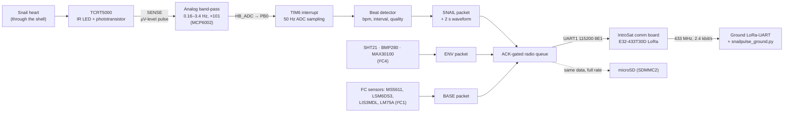

# How SnailPulse works: firmware and IntroSat integration

This document explains what the SnailPulse code does and how the payload plugs into the IntroSat.Platform that the Orbita organizers give every team. It is written for the jury, for teammates, and for future me before the flight.

Sources: `firmware/SnailPulse_Flight/*`, `ground/snailpulse_ground.py`, `hardware/kicad/Orbita26.kicad_sch` (rev B), and the organizers' *IntroSat.Platform short guide* (EN and RU, in `resources/`).

---

## 1. The whole chain in one picture



In words: an infrared sensor glued to the shell sees tiny changes in reflected light every time the heart beats. Our analog board turns that into a clean wave around 1.65 V on pin PB0 of the satellite's flight controller (FCM). The FCM samples it 50 times a second, finds the beats, and sends a small binary packet to the ground every 2 seconds through the platform's radio board. Everything is also written to the SD card at full rate. At the same time the FCM keeps the snail's box at 20 °C with a PWM heater, and a separate comparator on our board switches the heater off at about 40 °C even if the code crashes.

---

## 2. Where SnailPulse sits in the IntroSat stack

IntroSat.Platform is a 3U CubeSat kit made of stacked boards. We don't replace any of them. We add one board (the SnailPulse payload) and our own firmware on the existing flight controller.

| Platform module | What it is | How SnailPulse uses it |
|---|---|---|
| **Power module** | Takes the 4S Li-ion pack (14.8 V) on XT30 connector **X1**. Gives 3.3 V (3 A max), 5 V (3 A) and unregulated 14.8 V (6 A). Payload channels are switched on with jumpers on **X6**. | 3.3 V and 5 V reach us through IntroBus_L. The 14.8 V heater supply comes from **X8** (right-angle XT30-Female) with the kit's XT30 cable into our J2. **Red = +, black = −.** |
| **Flight controller (FCM)** | STM32H750VBT6. Service sensors on I²C1: LSM6DS3 (accel/gyro), LIS3MDL (magnetometer), MS5611 (barometer), LM75A (temperature). microSD on SDMMC2. Flashed over SWD on the **PROG** header. | Runs **our** firmware (`SnailPulse_Flight.ino`). Reads our analog signals and drives the heater through **IntroBus_L**. Talks to our I²C sensors on **I²C4**. |
| **Communication board** | Its own STM32 plus an Ebyte **E32-433T30D** LoRa module (410–441 MHz, 32 channels). Connected to FCM **UART1**. | We push binary frames into UART1. The board transmits them and answers **0x06 (ACK)** when it's done. |
| **IntroBus_S** | Internal bus between platform boards. | Not touched. The guide forbids connecting to it. |
| **IntroBus_L** (2×20 header) | The payload bus. | All our FCM signals and the 3.3 V / 5 V rails come from here. |

### 2.1 The IntroBus_L pins we use

From the pinout table in the IntroSat guide, matched to our connectors J5 (power) and J6 (signals):

| Our plug | Pin | Net | IntroBus_L / FCM pin | Pin function on the STM32 | Used for |
|---|---|---|---|---|---|
| J6 | 1 | HB_ADC | **PB0** | ADC | Heartbeat amplifier output |
| J6 | 2 | NTC1_ADC → **MQ7_AO** | **PB1** | ADC | Rev B: heater thermistor TH1. Rev C + fw 1.2: MQ-7 analog out |
| J6 | 3 | PWM → **DHT_DATA** | **PC6** | HRTIM_CHA1 / GPIO | Rev B: heater MOSFET gate (through R11). Rev C + fw 1.2: DHT-11 data |
| J6 | 4 | SCL | **PD12** | SCL4 | I²C4 clock to SHT21, both BMP280s, MAX30100 |
| J6 | 5 | SDA | **PD13** | SDA4 | I²C4 data |
| J5 | 1 | +5V | +5V_IS | — | LED driver R1, LM393 comparator U5 |
| J5 | 2 | +3V3 | +3V3_IS | — | Op-amp U2, sensors, thermistor dividers |
| J5 | 3 | GND | GND | — | Signal ground |
| J2 | 1 / 2 | +14V8 / GNDPWR | Power module **X8** | — | Heater only |

Why these pins: PB0 and PB1 are the two plain ADC inputs on the payload header, PC6 is a timer channel so `analogWrite()` gives real hardware PWM, and I²C4 is the bus the guide reserves for payloads (I²C1 is the platform's service bus and can't take payload devices).

### 2.2 Power budget

| Rail | Our load | Channel limit | Margin |
|---|---|---|---|
| +5V_IS | ≈ 18 mA (IR LED 17 mA + LM393) | 3 A | huge |
| +3V3_IS | < 25 mA (op-amp, dividers, three I²C modules) | 3 A | huge |
| 14.8 V (X8) | ≤ 0.34 A (heater 50 Ω; 5.6 W at a full 16.8 V pack) | 6 A | large |

The heater is the only real load. At 100 % duty it draws 0.30 A at 14.8 V (4.4 W), but the controller normally runs it far below that.

### 2.3 Two grounds, joined once

Heater current returns on **GNDPWR** (J2 pin 2, Q1 source, C6, R12). Everything else uses **GND**. On our board they meet at exactly one point, the net tie **NT1**. This keeps the 0.3 A heater pulses out of the ground the heartbeat amplifier measures against. Inside the platform both also go back to the same battery minus, so the FCM and our board share one reference.

---

## 3. Firmware layout

```
firmware/SnailPulse_Flight/
├── SnailPulse_Flight.ino   setup(), loop(), timer ISR, SD logging, packet builders
├── config.h                every pin, period, threshold and I²C address in one place
├── heartbeat.h/.cpp        beat detector (plain C++, unit-tested on a PC)
├── thermal.h/.cpp          thermistor maths + heater PI controller (unit-tested)
├── payload_sensors.h/.cpp  SHT21, BMP280, MAX30100 drivers on I²C4
├── fc_baro.h               non-blocking MS5611 driver for the FCM barometer
├── ms5611_comp.h           MS5611 datasheet compensation + ISA altitude
├── bmp280_comp.h           Bosch BMP280 compensation formulas
├── protocol.h/.cpp         frame format, CRC-16, packet structs (shared with the ground)
└── radio.h                 ACK-gated queue for the comm board
```

Rule followed throughout: anything that does maths (detector, heater, CRC, compensation) has **no Arduino dependency**, so `tests/test_host.cpp` can run it on a laptop with synthetic data.

### 3.1 What the organizers' code does and what ours does

| Job | Code |
|---|---|
| LSM6DS3, LIS3MDL, LM75A on I²C1 | **IntroStratLib** v0.1.2 (organizers' library, `firmware/libraries/IntroStratLib`) |
| MS5611 barometer | **Ours** (`fc_baro.h`). IntroStratLib's version blocks for ~80 ms per reading and gets the cold-temperature correction wrong (it reports about −163 °C at a real −1.6 °C). The test file shows the comparison. |
| UART1 setup, 115200 8E1 | Taken from the IntroSat guide |
| SD card on SDMMC2 | STM32SD library with the pins from the guide |
| Heartbeat, heater, payload sensors, packets, radio queue, watchdog | **Ours** |

---

## 4. Start-up: `setup()`

The order matters, so here it is step by step:

1. **Heater off first.** PC6 is set as an output and driven LOW before anything else. During the reset itself, R12 (10 kΩ to GNDPWR) already holds the MOSFET gate low, so the heater can never switch on while the MCU boots.
2. PWM is set to 8-bit resolution at 1 kHz.
3. **Was the last reset a watchdog reset?** `IWatchdog.isReset()` is checked and remembered. It goes out in the next STATUS packet, so the ground knows if the satellite rebooted itself.
4. UART1 to the comm board starts at 115200 baud, 8E1.
5. I²C1 (service bus): IMU, magnetometer, LM75A and our MS5611 driver start. Each result is stored as an "OK" flag. A missing sensor does not stop the boot.
6. I²C4 (payload bus) starts at 100 kHz, then SHT21, BMP280 and MAX30100. Again, a failure is noted and the flight continues.
7. SD card: up to three tries. It reads `BOOT.TXT`, adds 1 and writes it back. That **boot count** names the log files (`HB007.CSV`, `TLM007.CSV`), so a reboot never overwrites old data.
8. **TIM6 starts at 50 Hz** and calls `onSampleTick()`.
9. **Watchdog starts with 4 s.** From now on, if `loop()` ever stops for 4 s (a stuck I²C bus, a hung SD card), the MCU resets.
10. A first STATUS packet is queued so the ground sees the boot immediately.

---

## 5. Sampling the heartbeat: the timer interrupt

```cpp
void onSampleTick() {                      // runs 50 times per second
  v = analogRead(PB0);                     // heartbeat
  put (v, millis()) into a 128-slot ring buffer
  every 10th tick: mq7_sum += analogRead(PB1);   // MQ-7 at 5 Hz (rev B: heater thermistor)
  last_tick_us = micros();                 // the DHT-11 reads right after a tick
}
```

Why an interrupt: writing to the SD card or waiting for an I²C sensor can freeze `loop()` for tens of milliseconds. If the heartbeat were sampled in `loop()`, those freezes would bend the time axis and the beat intervals would be wrong. The interrupt fires on time no matter what `loop()` is doing. It stores a timestamp with every sample, so even the detector's maths uses the real sample time.

The ring buffer holds 128 samples = 2.5 s. `loop()` empties it every pass, which normally takes a few milliseconds, so it never fills. If it ever did, the overrun is counted instead of crashing.

Numbers worth knowing: the ADC is 12-bit over 3.3 V, so **1 count = 0.81 mV** at PB0. Because the analog gain is 101, one count is about **8 µV at the sensor**. The detector needs at least 6 counts of pulse (≈ 50 µV at the sensor) to call it a signal.

---

## 6. The main loop

`loop()` never waits. Every pass does five things and then pets the watchdog:

| Step | What happens | How often |
|---|---|---|
| 1 | Drain the ring buffer. Each sample goes to the beat detector and to the SD buffer. A detected beat blinks the user LED (PE10) for 150 ms. | every pass |
| 2 | `sht.poll()` and `baro.poll()`: these drivers are **state machines**. They start a measurement, return immediately, and pick up the result on a later pass. | every pass |
| 3 | Slow work: convert NTC1 to °C, read BMP280 and MAX30100, run the heater controller, write the new PWM duty. | once per second |
| 4 | Telemetry schedule: SNAIL and BASE every 2 s, ENV every 4 s, STATUS every 10 s. Then `radio.poll()`. | as scheduled |
| 5 | Flush the SD buffers. | once per second |

The worst loop time of the last 10 s is measured and sent in STATUS (`loop_max_ms`). If that number grows on the bench, something is blocking.

---

## 7. How a beat is found (`heartbeat.cpp`)

The analog board has already removed the steady light level (high-pass at 0.16 Hz) and fast noise (low-pass at 3.4 Hz). The firmware still has to decide, sample by sample, "was that a beat?". It does it in four steps:

1. **Smooth.** A first-order low-pass with a time constant of 80 ms removes the last bit of noise.
2. **Find the middle.** A much slower filter (6 s time constant) tracks the baseline. The signal we look at is `d = smoothed − baseline`.
3. **Measure the size of the pulses.** An envelope follower jumps up to any new peak of |d| and decays slowly (6 s). So the envelope is "how big the recent beats are", and it adapts if the sensor moves or the signal weakens.
4. **Decide.** A beat is counted when `d` crosses **upwards through 40 % of the envelope**. After that, the detector is disarmed until `d` falls back below 10 % of the envelope. This stops one wide pulse from counting twice.

Extra rules make it robust for a snail:

- **Refractory time.** Nothing faster than 0.4 s (150 bpm) is accepted. Once a rhythm is known, a second "beat" earlier than 40 % of the usual interval is ignored. A real sudden doubling of the rate (interval drops to 50 %) is still followed.
- **Rate = median of the last 5 intervals**, not the average. One missed or one extra beat changes the average a lot but barely moves the median.
- **Valid range: 3 to 150 bpm.** If no beat arrives for 20 s, the rate is reported as 0 (contact lost, or the heart stopped).
- **Quality 0–100.** Computed from how regular the last five intervals are: identical intervals give 100, a spread of 50 % gives 0. It is halved if the ADC clipped, and reduced if the pulse is weak.
- **Warm-up.** The first 2 s of data only train the filters.

The detector also keeps a **10 Hz, 8-bit copy of the raw signal** (the average of every 5 samples, top 8 bits). The last 20 of those go in every SNAIL packet. That is exactly 2 s, matching the packet period, so the ground receives a continuous waveform and can recount the beats itself. We don't have to trust the onboard algorithm.

Tested on the PC with synthetic snail pulses at 4 to 120 bpm, a sudden step from 10 to 25 bpm, and pure noise (it correctly reports 0 bpm and quality 0).

---

## 8. Keeping the snail warm (`thermal.cpp` and the hardware cutoff)

### 8.1 Reading a thermistor

TH1 sits at the bottom of a divider with a 10 kΩ resistor to 3.3 V. The ADC uses the same 3.3 V as its reference, so the reading is a pure **ratio** and supply drift cancels out:

```
ratio = adc / 4095 = R_ntc / (10k + R_ntc)   →   R_ntc = 10k · ratio / (1 − ratio)
1/T = 1/298.15 + ln(R_ntc / 10k) / 3950      (Beta equation, T in kelvin)
```

A reading within 8 counts of 0 or 4095 means the wire is shorted or broken. It returns "not a number", and the controller treats the sensor as failed.

### 8.2 The controller

Once a second, `HeaterController::update()` picks one of four modes:

| Mode | When | What it does |
|---|---|---|
| **1 · box control** | SHT21 works | PI loop on the box air: duty = 40 × error + integral (integral grows by 0.5 × error per second, clamped 0–255 so it can't wind up). Target 20 °C. |
| **2 · plate only** | SHT21 failed, TH1 works | Holds the heater plate at 25 °C (10 °C below its limit). |
| **3 · blind** | Both failed | Fixed 20 % duty ≈ 0.9 W. Enough to slow the cooling, low enough to be safe. |
| **0 · off** | Plate at or above 35 °C | Heater off. |

On top of every mode: if TH1 works, the duty **tapers to zero over the last 3 °C** before 35 °C. If TH1 is dead, the duty can never exceed 50 % (≈ 2.2 W).

### 8.3 Four layers of heater safety

1. **R12** holds the gate low during reset and boot.
2. **Software limit** of 35 °C on the plate (TH1).
3. **Hardware cutoff**: TH2 feeds the LM393 comparator (U5). Above ≈ 40 °C (RV2 set to ≈ 1.1 V), U5's open-collector output pulls GATE to ground through its own path, overpowering PC6 through R11. **No code is involved**, so it works even if the MCU hangs with PWM stuck on.
4. **Watchdog**: a frozen `loop()` resets the MCU within 4 s. During the reset PC6 floats and R12 pulls the gate low.

A known limit, documented in the schematic review: if the TH2 wire breaks, the comparator sees "very cold" and won't trip. Layer 2 still protects the snail as long as TH1 works.

---

## 9. The other sensors

| Sensor | Bus / address | Driver | Notes |
|---|---|---|---|
| SHT21 (GY-21) | I²C4 · 0x40 | ours, non-blocking state machine | Box air temperature and humidity. The heater controller's main input. |
| BMP280 #1 | I²C4 · 0x76 (SDO → GND via J8.5) | ours, Bosch integer formulas | Box pressure. Range 300–1100 hPa, which is fine inside a sealed box. If it drops out, it is re-initialised once a second (up to 100 errors). |
| MAX30100 | I²C4 · 0x57 | ours, IR only | Backup optical pulse signal; raw IR in the ENV packet. Many boards pull I²C up to 1.8 V: if it won't answer, remove its 4.7 kΩ pull-ups. |
| BMP280 #2 (added 29 Oct) | I²C4 · 0x77 (SDO → VCC) | same driver, second object | A second box-pressure reading on the same bus wires, as a cross-check. Retried the same way; ENV bit 7. |
| DHT-11 (added 29 Oct) | GPIO · PC6 | ours (`DHT11` in `payload_sensors`, decoding in `dht11_decode.h`) | Second box temperature/humidity, ±2 °C / ±5 %RH, read every 2 s. The 20 ms start signal is non-blocking; the ~5 ms bit read starts right after the 50 Hz ISR so the interrupt can't stretch a bit. A bad checksum is just retried; 3 failures in a row clear its OK bit. |
| MQ-7 (added 29 Oct) | ADC · PB1 | ours, sampled in the ISR at 5 Hz | CO-sensitive tin-oxide sensor. ENV carries the 1 s average of AO in mV. On 3.3 V its heater runs at ~45 % power, so the reading shows changes, not calibrated ppm. Keep its warm can away from the snail and the SHT21. |
| MS5611 (on the FCM) | I²C1 · 0x77 | ours (`fc_baro.h`) | Outside pressure down to 10 mbar. Altitude uses the full ISA model, valid above 11 km (at 30 mbar the simple formula says 21.7 km, ISA says 23.9 km). |
| LSM6DS3, LIS3MDL, LM75A (FCM) | I²C1 | IntroStratLib | Acceleration, rotation, magnetic field, board temperature for the BASE packet. |

---

## 10. Talking to the ground

### 10.1 Frame format

Every packet is a frame like this:

```
AA 55 | type | seq | len | payload (len bytes) | CRC-16 (little-endian)
```

- `AA 55` marks the start. The ground parser searches for it, so it recovers after garbage.
- `seq` counts 0–255. Gaps on the ground mean lost frames.
- CRC-16/CCITT over type…payload. A frame with one wrong bit is thrown away, never shown as data.
- **Each frame is at most 58 bytes.** The E32 module sends data in 58-byte packets and adds a noticeable pause after each one, so one frame = one radio packet is the fastest and safest choice (IntroSat guide, RU, "Особенности радиомодуля").

The guide also recommends sending raw binary numbers instead of text. A text line like `gx:0.12;gy:0.315;gz:0.023` is 25 bytes for 12 bytes of data, and it loses precision. All our fields are fixed-point integers (for example temperature × 100).

### 10.2 The four packets

| Type | Every | Frame size | Main fields |
|---|---|---|---|
| `0x10` SNAIL | 2 s | 46 B | bpm × 10, last interval, beat count, quality, flags (beat seen / clipped / no signal), pulse amplitude, DC level, **20 waveform samples** |
| `0x01` BASE | 2 s | 41 B | MS5611 pressure, temperature, ISA altitude; acceleration, rotation, magnetic field; FCM board temperature |
| `0x11` ENV | 4 s | 43 B | box T and RH (SHT21), box pressure and T from both BMP280s, MAX30100 IR, sensor-OK bits, DHT-11 T and RH, MQ-7 mV (fw 1.2; the heater fields are empty on rev C) |
| `0x7F` STATUS | 10 s | 31 B | firmware version, boot count, frames sent / un-ACKed / dropped, I²C and SD errors, worst loop time, watchdog-reset flag, FC sensor-OK bits (`fc_ok`: bit0 LSM6DS3, bit1 LIS3MDL, bit2 LM75A, bit3 MS5611) |

Average load: 23 + 20.5 + 7.75 + 3.1 ≈ **54 bytes/s ≈ 0.43 kbit/s**, about 18 % of the 2.4 kbit/s air rate. The spare capacity absorbs retries and slow ACKs.

### 10.3 The ACK-gated queue (`radio.h`)

The comm board can buffer up to 4096 bytes, transmits what it receives, and **answers 0x06 on UART1 after the data has gone out**. Our `RadioLink` uses that:

1. Packets are built into an 8-slot queue.
2. `poll()` sends one frame, then waits for 0x06.
3. When the ACK arrives, the next frame goes. If no ACK arrives within 1.5 s, it counts a missed ACK and sends the next one anyway, so a lost ACK can't freeze the telemetry.
4. If the queue is full, the **oldest** frame is dropped and counted. Fresh data is more useful than stale data.

The three counters go in every STATUS packet, so the ground can see the health of the link.

### 10.4 The ground station

`ground/snailpulse_ground.py` reads the ground LoRa-UART module, finds frames, checks the CRC, decodes them with the same layouts as `protocol.h`, prints them, and writes `snail.csv`, `waveform.csv`, `base.csv`, `env.csv`, `status.csv`. Every raw byte also goes to `logs/raw_<time>.bin`, so a decoding bug can be fixed after the flight without losing data. `--plot logs/` draws the waveform, heart rate and temperatures.

The ground module's baud rate and parity are whatever its RF settings say. They are **not** the 115200 8E1 used between the FCM and the comm board. The channel, air rate and FEC must match the satellite's comm board.

---

## 11. The SD card

| File | Contents | Rate |
|---|---|---|
| `BOOT.TXT` | boot counter | each boot |
| `HBnnn.CSV` | `t_ms,hb_adc`: the full 50 Hz heartbeat signal, 12-bit | 50 lines/s |
| `TLMnnn.CSV` | every SNAIL, BASE and ENV packet, as text | 1.25 lines/s |

The heartbeat lines are collected in a 1.5 kB RAM buffer and written in blocks. Both files are flushed once a second, so a power cut loses at most about 1 s. The radio carries a 10 Hz, 8-bit copy; the SD card has the 50 Hz, 12-bit original for the post-flight analysis.

---

## 12. What happens when something fails

| Failure | What the firmware does | What the ground sees |
|---|---|---|
| Sensor slips off the shell | Envelope drops below 6 counts → rate 0 | SNAIL: bpm 0, quality 0, flag "no signal"; flat waveform |
| Too much light, amplifier clips | Counts samples outside 40–4055 | SNAIL flag "saturated", quality halved |
| SHT21 dies | Heater switches to mode 2 (plate at 25 °C) | ENV: sensors-OK bit 0 cleared, heater mode 2 |
| SHT21 and TH1 die | Mode 3, 20 % blind heating; LM393 still armed | ENV: mode 3 |
| A BMP280 or the MAX30100 dies | Flight continues; BMP280s are retried | ENV: bit 1 (BMP280 #1), bit 7 (#2) or bit 2 (MAX30100) cleared |
| DHT-11 stops answering | Retried every 2 s; flight continues | ENV: bit 5 cleared, DHT fields n/a |
| MQ-7 wire off or saturated | Value still sent | ENV: bit 6 cleared (AO below 5 mV or above 3.29 V) |
| I²C bus locks up | `loop()` stalls → watchdog reset in 4 s | STATUS: boot count +1, reset cause 1 |
| SD card missing or full | Logging stops; radio continues | ENV: SD bit cleared; STATUS: SD errors |
| Comm board ACK lost | Sends the next frame after 1.5 s | STATUS: acks_missed rises |
| Code hangs with heater on | LM393 cuts the heater at ≈ 40 °C; watchdog resets the MCU | Plate temperature stops near 40 °C, then a reboot |

---

## 13. Build, flash and test

### 13.1 On a laptop, no hardware needed

```
cd firmware/tests
g++ -std=c++17 -O1 -Wall -I../SnailPulse_Flight test_host.cpp ../SnailPulse_Flight/protocol.cpp \
    ../SnailPulse_Flight/heartbeat.cpp ../SnailPulse_Flight/thermal.cpp -o test_host && ./test_host
```

This checks the CRC, the frame parser (including corrupted frames), the beat detector on synthetic snail pulses, the NTC maths, the heater fallbacks, a 3-hour thermal simulation at −40 °C, the BMP280 and MS5611 maths against the datasheets, and the radio queue's ACK, timeout and overflow handling.

### 13.2 Flashing the FCM

1. Arduino IDE → Board Manager → **STM32 MCU based boards**. Board: Generic STM32H7, part **STM32H750VBTx**, upload by **STM32CubeProgrammer (SWD)**.
2. Libraries: **IntroStratLib**, **STM32SD**, **FatFs**.
3. ST-Link to the **PROG** header: SWCLK → CLK, SWDIO → SWD, GND → GND. Don't power the stack from the ST-Link's 3.3 V when the power module is connected.
4. **BOOT0 jumper on 0** (normal run), then Upload.

### 13.3 Bench bring-up, in order

1. Power module with the 12 V supply, payload channels on (X6 jumpers), antenna connected before any transmission.
2. Flash `tools/HB_Tune`. Hold the TCRT5000 over the snail's heart, measure SENSE (J1 pin 4) to GND and turn **RV3** until it reads about 0.8–2.0 V. Wait ~5 s after each turn for the high-pass to settle. Open the Serial Plotter: a slow regular wave every 1–10 s should appear.
3. Set **RV2** so its wiper reads ≈ 1.1 V (≈ 40 °C cutoff). Warm TH2 with your fingers or a hair dryer and confirm the heater switches off.
4. Flash `SnailPulse_Flight`. Start the ground script. Check that a STATUS packet arrives and says fw 1.2, then that the ENV sensors-OK bits read 0xF7 (rev C: no heater NTC, so bit 3 stays clear).
5. Long run: the full stack in a freezer for ~3 hours, watching box temperature, heater duty and heart rate on the ground screen.

### 13.4 Not yet verified on real hardware

Firmware 1.2 compiles for the STM32H750 (board package 2.12.0) and the PC tests pass, but it has **not run on the flight controller yet**. The DHT-11 read and the MQ-7 sampling are new in 1.2 and are part of that first run. Step 4 above is the first real test. Things to watch on that first run: `analogRead()` inside the timer interrupt (STM32duino's version is slow but works; if `loop_max_ms` or ISR overruns look wrong, move sampling to ADC + DMA), the comm board actually returning 0x06, and the MAX30100's 1.8 V pull-ups.
