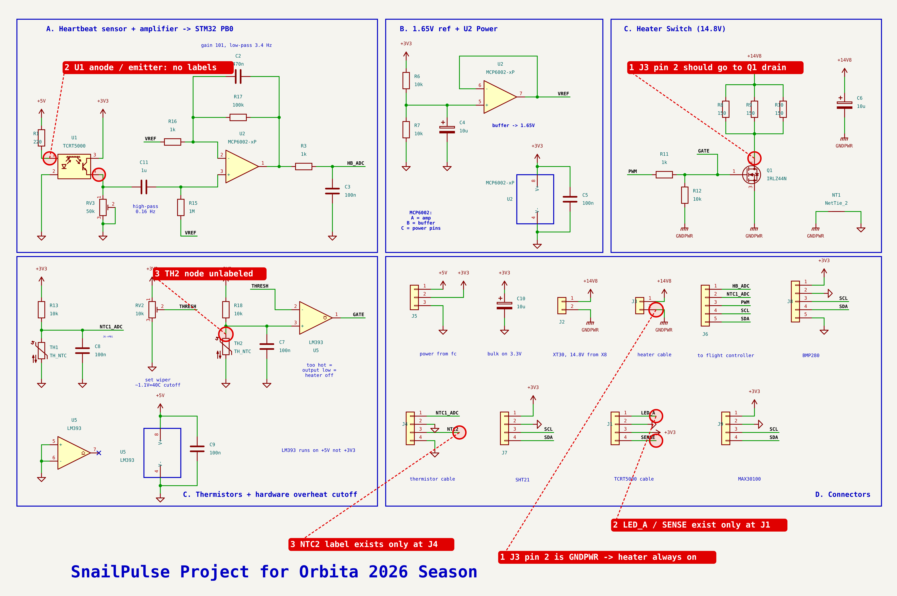

# SnailPulse schematic review — rev A (22 Oct 2026)

I checked `hardware/kicad/Orbita26.kicad_sch` by extracting its netlist and comparing it with `hardware/SnailPulse_KiCad_Connections.xlsx`, the intended design.

## Must fix before wiring the board

| # | Where | What is wrong | Fix |
|---|---|---|---|
| 1 | **J3 "heater cable"** | Pin 1 = +14V8 and **pin 2 = GNDPWR**. The heater bank (R8–R10) is off-board, so a heater plugged into J3 sits **straight across the battery and is always on**. Q1, the firmware PWM and the LM393 cutoff can't switch it. | Remove the GNDPWR symbol from J3 pin 2 and label it `HEATER_LO`. Put the same label on Q1 drain (the R8/R9/R10 junction). |
| 2 | **J1 "TCRT5000 cable"** | `LED_A` (pin 1) and `SENSE` (pin 4) are labels that exist **only at J1**, so both pins are unconnected. | Add a `LED_A` label on the R1 → U1 anode wire and a `SENSE` label on the U1 emitter / RV3 / C11 node. |
| 3 | **J4 pin 3 `NTC2`** | Same problem: the label exists only at J4. TH2's node (R18 / C7 / LM393 pin 3) has no label, so the cutoff thermistor in the cable is **not connected to the comparator**. | Add an `NTC2` label on the R18–TH2–C7–U5 pin 3 node. |

After these fixes, every net matches the workbook. The only other differences are reference numbers (for example, the workbook's R14 is the schematic's R13).

## Should fix (ERC, PCB, documentation)

- **No PWR_FLAG symbols.** All power arrives through connectors (passive pins), so ERC reports "power input not driven" on +3V3, +5V, GND, +14V8 and GNDPWR. Add one PWR_FLAG per power net.
- **U1, TH1, TH2 have "Exclude from board" turned off.** They are physically at the end of a cable, so tick it as you already did for R8–R10. Otherwise the PCB gets footprints for parts that live on the snail.
- **Footprints are missing** on all R, C, RV, U2, U5, J2, J3, J5, J6, J8 and NT1. This is fine for perfboard, but the BOM export and any PCB need them. The workbook's *Parts* tab already lists the right ones.
- **Reference gaps:** R2, R4, R5, R14, C1, U3 and U4 are missing. Run *Annotate* again before exporting the BOM. Jurors notice gaps.
- `J6->PB1` near TH1 is tiny text. Use the 1.27 mm size like the other notes.

## Block-by-block check

**A — Heartbeat sensor and amplifier → PB0** ✅ (after fix 2)
- LED current: (5 V − 1.25 V) / 220 Ω ≈ **17 mA** (TCRT5000 max 60 mA). OK.
- Phototransistor wired as an emitter follower into RV3 (50 k rheostat): V_E = I_E · R_RV3, and it can never exceed 3.3 V. OK.
- High-pass C11 · R15 = 1 µF · 1 MΩ: **f_c = 0.159 Hz**, τ = 1 s. C11 is ceramic, which is correct here: the DC across it can be either polarity.
- Non-inverting gain 1 + R17/R16 = **101 (40 dB)**. Low-pass R17 · C2: **f_c = 3.39 Hz**. At high frequency the gain falls to 1, not 0, because the stage is non-inverting. R3/C3 (1.59 kHz) finishes the job and holds charge for the ADC's sample capacitor.
- DC output = VREF + 101 × V_os. MCP6002 V_os is at most ±4.5 mV, so the output can sit at **1.65 ± 0.45 V**. That is fine for the ADC, but expect HB_ADC's resting level to differ from 2048.
- Very slow hearts: at 4 bpm (0.067 Hz) the high-pass passes about 40 % (−8 dB). It still works (the firmware test covers 4 bpm). For dormant snails, 2.2 µF would move the corner to 0.07 Hz but makes start-up settling about 2× longer.

**B — 1.65 V reference** ✅
- Divider 10 k / 10 k → 1.65 V. C4 10 µF with 5 kΩ Thevenin resistance → 3.2 Hz noise filter. Buffered by the MCP6002 B half, so loading by R15/R16 doesn't shift it. There is no capacitor on the buffer output, which is correct: op-amps can oscillate driving capacitive loads.
- U2 power: +3V3/GND with C5 100 nF plus the bulk C10 10 µF. OK.

**C — Heater switch (14.8 V)** ❌ until fix 1
- Heater: 3 × 150 Ω in parallel = 50 Ω. At 14.8 V: **0.30 A, 4.4 W** (1.46 W per resistor, rated 5 W). Full battery (16.8 V): 5.6 W. Near-empty battery (12.8 V): 3.3 W.
- IRLZ44N is a logic-level MOSFET. R11/R12 give a gate voltage of 3.3 × 10/11 = **3.0 V**: above V_th (1–2 V) and plenty for 0.3 A. Loss ≈ I²·R_DS(on) ≈ 3 mW, so no heatsink is needed. No flyback diode is needed because the load is resistive.
- R12 10 k keeps the gate low while the MCU boots or resets. Good.
- C6 10 µF on +14V8 must be rated ≥ 25 V (the BOM says 50 V ✅).
- NT1 joins GNDPWR to GND at one point, so heater current doesn't flow through the analog ground. Good practice.

**C — Thermistors and hardware cutoff** ✅ (after fix 3), plus two design notes
- NTC 10 k (B ≈ 3950) under a 10 k pull-up: 25 °C → 1.65 V, **40 °C → 1.143 V**, −20 °C → 3.0 V. About −30 mV/°C near 40 °C.
- LM393 on +5 V: its input common-mode range is 0 to V_CC − 1.5 V, so +5 V lets it accept the whole 0–3.3 V range. Its open-collector output can only pull GATE **down**, so it overrides the PWM through R11. It sinks 3.3 V / 1 k = 3.3 mA (LM393 sinks ≥ 6 mA). This works even if the MCU hangs.
- Spare comparator B: inputs to GND, output with a no-connect flag. Correct.
- *Note 1 — no hysteresis.* Near 40 °C the comparator can chatter. C7 and the heater's thermal mass make it behave like a crude proportional limiter, and at 0.3 A the MOSFET can't overheat even in its linear region. This is acceptable, but be ready to explain it.
- *Note 2 — fail-unsafe on an open thermistor.* If the TH2 wire breaks, R18 pulls pin 3 to 3.3 V, which reads as "very cold", so the cutoff never trips. The firmware covers this: it reads NTC1 and switches the heater off above 35 °C. An improvement would be to use the spare comparator as an "open-wire" detector, for example tripping above 3.1 V.

**D — Connectors** ✅ (after fixes)
- J5 power from the flight controller (5 V, 3V3, GND from IntroBus_L, the payload "_IS" rails). J6 signals to the FC: PB0, PB1, PC6, PD12 (SCL4), PD13 (SDA4). These match the IntroBus_L pinout.
- J2 XT30 from port X8 (14.8 V unregulated, 6 A max on that channel).
- I²C pull-ups come from the modules (GY-21 and BMP280 each have about 10 k). **MAX30100 modules usually pull up to 1.8 V.** If the STM32 can't read it, remove the module's 4.7 k pull-ups.
- **BMP280 only measures 300–1100 hPa** (down to about 9 km). It's fine for a sealed box. Outside pressure at 24 km (about 30 hPa) is below its range; the FC's MS5611 (10–1200 mbar) covers that.

## Checked and correct

Polarity of C4, C6 and C10 · U2 and U5 power pins · Q1 G/D/S · RV2 as a divider (3V3–wiper–GND) · RV3 as a rheostat (wiper tied to its own end) · the VREF buffer feedback · the PWM path · power nets for every module · no dangling wire ends · only one intentional no-connect (U5 pin 7).
